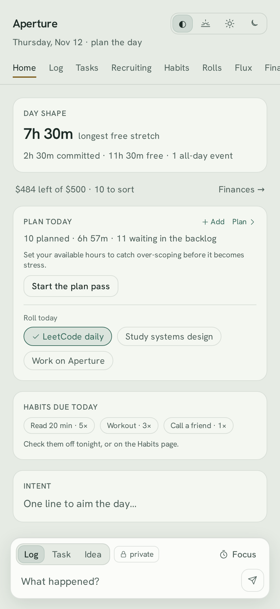
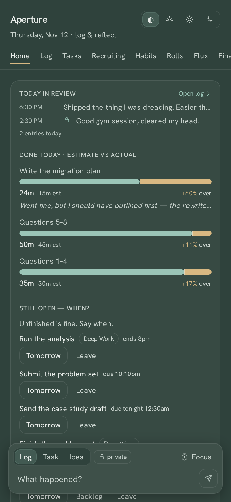
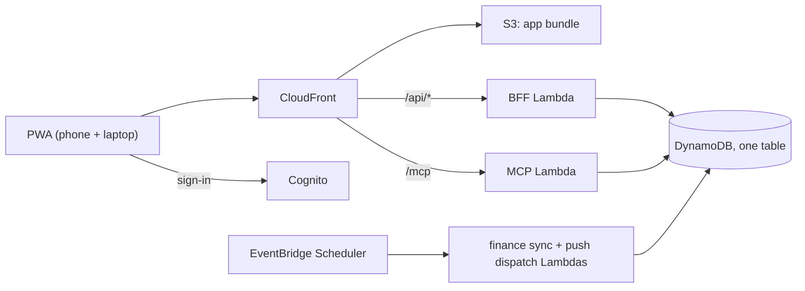

# Aperture

A personal life-OS PWA — one place for everything digital in one person's life. Web-first, installable, multi-device.

Aperture exists to make its user **calmer and more honest about their time**, not just to log more output. Its #1 job is a morning + night ritual (glance, plan, reflect), with the signature move being **calibration** — surfacing the gap between what a task was _estimated_ to take and what it _actually_ took, so under-scoping gets caught instead of repeated.

Not a mood tracker, not a habit-shaming app, not a productivity cult. Balance is invited, never policed.

<p>
  
  
</p>

<sub>Phone width, on the built-in stub data — every name, number and entry is made up.</sub>

---

## What it does (v2)

v1 was the ritual app — [`docs/V1_PLAN.md`](docs/V1_PLAN.md) phases 0–14, kept as the plan as written. v2 is everything built on it since. Each line below points at the design doc that owns it.

**The ritual core (v1)**

- **Glanceable home** — auto morning / day / night by clock, ≤5 things per mode. Home is glance; deep views are work.
- **Global capture bar** — always present, frictionless in.
- **Tasks + calibration** — the signature module. Estimate freezes when work starts; calibration is `actual` vs `frozen estimate`, and no task finishes without both ([calibration integrity](docs/areas/calibration/integrity.md)). Multi-day scheduling, recurrence, categories.
- **Pomodoro** — persistent heartbeat-backed timer that follows you across views; pauses excluded; only work sessions accrue.
- **Rolls** — deadline-free ongoing efforts with a forgiving momentum "contact sheet" (fills, never a resetting streak) ([rolls](docs/areas/home/rolls.md)).
- **Log / journal**, **habits**, **inbox** (idea triage), **settings**.

**Since v1**

- **Tasks grew up** — [due dates + times](docs/areas/tasks/due-dates.md), [parent + parts](docs/areas/tasks/parts.md) and [split](docs/areas/tasks/split.md), [recurring cadences](docs/areas/tasks/recurring.md), [notes](docs/areas/tasks/notes.md), [attachments](docs/areas/tasks/attachments.md), a [reflection](docs/areas/tasks/reflection.md) line at Done, [life areas](docs/areas/tasks/areas.md), and the Today · Week · Backlog · Done [lenses](docs/areas/tasks/lenses.md), all in one [task editor](docs/areas/tasks/task-editor.md).
- **Quick add** — a natural line parsed by Claude Haiku, server-side ([quick-add](docs/areas/tasks/quick-add.md)); a strict [bulk-add](docs/areas/tasks/bulk-add.md) grammar for pasting many.
- **Places** — errand lists with one-tap check-off, and an iPhone Shortcut that surfaces a store's list on arrival ([places](docs/areas/tasks/places.md)).
- **Reminders** — Web Push to the installed PWA for deadlines and planned tasks ([reminders](docs/areas/tasks/reminders.md)).
- **Google Calendar, two-way** — the morning's day shape, and timed tasks synced as events both ways ([calendar](docs/areas/calendar/index.md)).
- **Finances** — a three-bucket budget over a bank feed via Plaid ([finances](docs/areas/finances/index.md)).
- **Flux** — webcam-guided neck exercises with on-device face tracking, saved history and trends; a session is a Roll rep ([flux](docs/areas/flux/index.md)).
- **Recruiting** — LeetCode sittings captured by a Safari extension, plus a behavioral [story bank](docs/areas/recruiting/story-bank.md) ([recruiting](docs/areas/recruiting/index.md)).
- **MCP connector** — Claude Code and claude.ai read and write Aperture through one `/mcp` endpoint, which also carries voice capture and a Raycast hotkey ([mcp](docs/areas/mcp/index.md)).
- **Private log entries** — kept out of every MCP read and search ([log](docs/areas/log/index.md)).

The full map, with what's still open, is [`docs/index.md`](docs/index.md).

## How it's built



React + Vite + TypeScript PWA on an **AWS-native serverless BFF**. The one-paragraph shape is
[`CLAUDE.md`](CLAUDE.md) → Architecture; the blueprint is [`docs/arch/INFRA.md`](docs/arch/INFRA.md)
(§4 for the Function URL + origin-secret edge, §11 for why it costs effectively $0 at single-user
scale). Multi-device sync is **structural** — laptop and phone hit the same table under the same
identity ([`docs/arch/TECH.md`](docs/arch/TECH.md) §1).

**AWS cost:** effectively free at single-user scale — DynamoDB, Lambda and Cognito sit inside the always-free tiers, and the only real line item is S3 + CloudFront, in pennies ([INFRA §11](docs/arch/INFRA.md#11-cost)).

## Status

Built and in daily use. What's shipped and what's still open is the block at the top of [`docs/index.md`](docs/index.md); CI (`.github/workflows/`) is the test status, on every PR and every push to `main`.

## Develop

Requires **Node 22** (see `.nvmrc`) and **pnpm** — its version comes from `packageManager` in `package.json`, via corepack (`corepack enable pnpm`).

```bash
pnpm install       # install the workspace
pnpm dev           # run the app (Vite) → localhost:5173 (6173 inside a COI container)
pnpm typecheck     # tsc -b across all packages (project references)
pnpm lint          # eslint (flat config); lint:fix to apply fixes
pnpm format        # prettier write; format:check to verify
pnpm test          # vitest across all packages
pnpm build         # production build
```

Testing the deployed dev stage: `pnpm devcheck` ([DEV-CHECK](docs/ops/DEV-CHECK.md)), and its container-local pre-flight `pnpm devcheck:local` ([LOCAL-CHECK](docs/ops/LOCAL-CHECK.md)). The rest of the root scripts are maintainer tooling — [`docs/index.md`](docs/index.md) → _ops/_.

Monorepo layout: `app/` (React PWA) · `lambdas/` (BFF) · `cdk/` (infra) · `packages/shared/` (the cross-cutting contract) · `extension/` (the Safari LeetCode extension) · `scripts/` (dev/CI utilities) · `tools/` (Mac-side clients) · `docs/`.

Development runs Claude Code inside an Incus container: the runbook — and the rules that bite there — is [`docs/ops/COI-SANDBOX.md`](docs/ops/COI-SANDBOX.md), the post-mortems [`docs/ops/COI-INCIDENTS.md`](docs/ops/COI-INCIDENTS.md).

## Conventions

**pnpm only**, one test runner (Vitest, Node parity for the Lambda), first-principles dependency
discipline — the full rules are [`docs/product/CONVENTIONS.md`](docs/product/CONVENTIONS.md); the
load-bearing ones are repeated in `CLAUDE.md`.

Docs: [`docs/index.md`](docs/index.md).

## License

MIT — [`LICENSE.md`](LICENSE.md).
